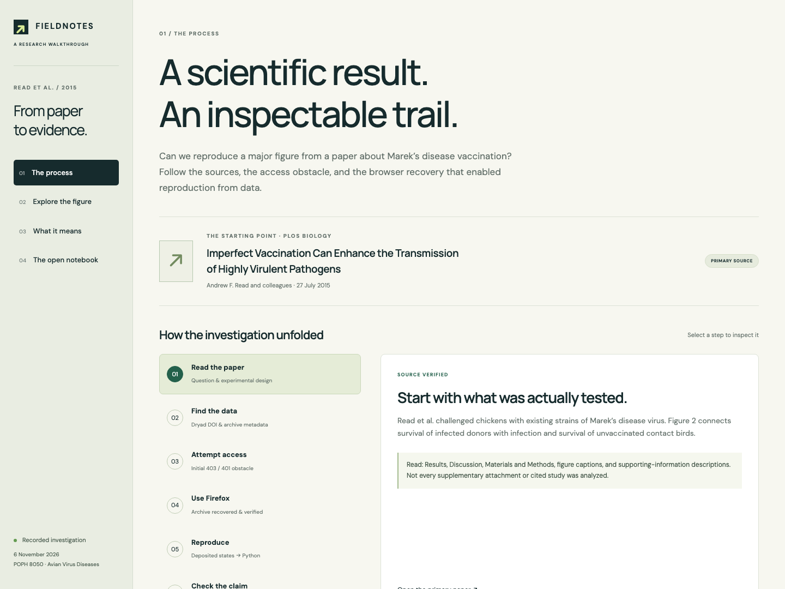
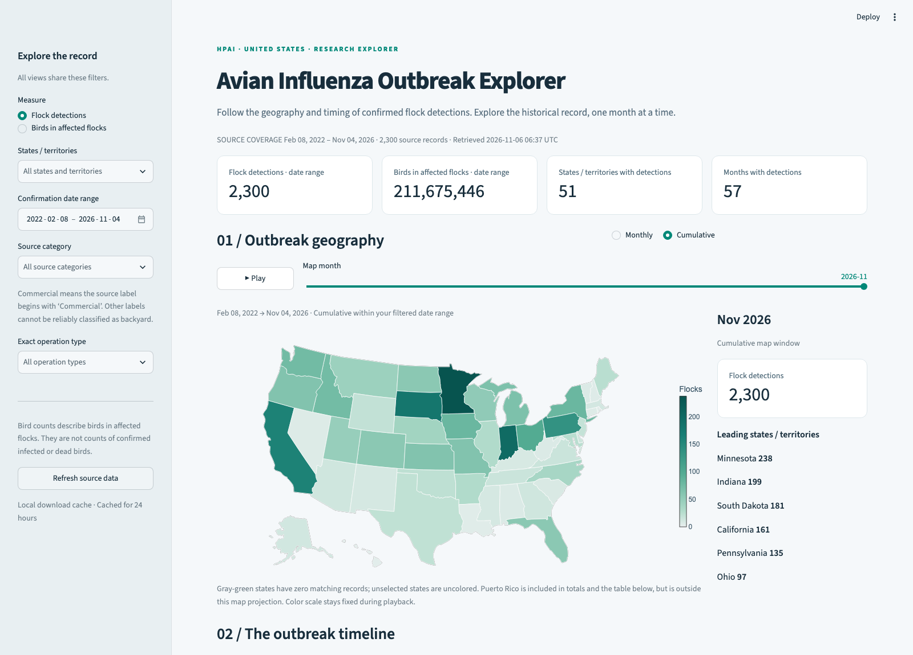

# Scientific Research in the Age of AI Agents

Get the [slides here!](https://docs.google.com/presentation/d/1CjmDeR3eX8qM--d1vayP2hyykuaqjQPHKePj2W4_XoU/edit?usp=sharing)

Three hands-on demos for **POPH 8050: Avian Virus Diseases**. They show how an AI coding assistant can help you inspect published evidence, build an interactive data explorer, and carry out a public-data investigation. You do not need to understand the code to explore the demos or ask Codex to run them.

All three demos are already built. **Opening a demo shows saved work; it does not ask AI to conduct a new investigation.** Recalculating the analyses is a separate option below.

## Start here with Codex

1. Get a copy of this project: on [the GitHub project page](https://github.com/mahaloz/POPH8050_lecture), choose **Code → Download ZIP**, then unzip it. If you already have a copy, use that folder.
2. Give Codex access to the `guest-lecture-poph8050` folder. This is the folder containing this README and the three `demo` launch files.
3. Paste this request, replacing `1` with whichever demo you want:

   > Please run demo 1 in this project. Read README.md and that demo's own instructions first. Check which software my computer needs, help me install anything missing, start the demo, and give me its browser address. Explain each step in everyday language. Use the saved data and results; do not refresh data or rerun the analysis. Then walk me through the suggested activities and explain the takeaways and limitations.

4. Open the address Codex gives you in your web browser. The demo runs on your computer. An address starting with `localhost` or `127.0.0.1` means “this computer.”
5. When you are finished, ask Codex to stop the demo. If you started it yourself in a terminal, press **Ctrl+C** in that terminal.

**What you need:** a web browser and Python, the software that runs the demos. Demos 1 and 3 need only Python 3 to display the saved work. Demo 2 needs Python 3.10 or later and installs extra packages on its first launch; if `uv` (a Python setup tool) is installed, its launcher selects Python 3.12. Codex can help with setup. Internet is needed to obtain the project, use Codex, and install packages. Demos 1 and 3 display their saved content offline; demo 2 can fall back to its bundled data after its software is installed.

## Pick a demo

| Demo | What you will do | Main lesson |
| --- | --- | --- |
| **1. From paper to evidence** | Explore a published figure and inspect how it was reproduced. | A convincing graph needs an inspectable trail back to its data. |
| **2. Outbreak Explorer** | Filter and animate a map of U.S. bird flu detection records. | An interactive tool makes patterns easier to explore, but the meaning of each count matters. |
| **3. Bird Flu Research Investigation** | Read an executed investigation with hypotheses, tests, and eight figures. | AI can assemble a research workflow; people still need to evaluate the evidence and conclusions. |

## Demo 1: From paper to evidence

This walkthrough follows the reproduction of Figure 2 from a 2015 paper about Marek's disease vaccination. It includes the published figure, the deposited data, the original calculation code, and a Python reproduction. It also preserves the history of an earlier image-only attempt, which was superseded when the actual data became available.



**Open it with Codex:** use the starter request above with `demo 1`.

**Or start it yourself:** from the project folder, run this in a terminal (the app where you type commands), then open **http://localhost:8080**:

```bash
python3 research-walkthrough/serve.py
```

**Try this:**

1. In **The process**, select the investigation steps. Notice the distinction between reading values from an image and calculating them from the authors' deposited data.
2. Open **Explore the figure**. Switch among the three panels and move the day slider. Read the fractions beneath the graph as well as the lines.
3. Switch **Presentation** between daily states and publication lines. The published plotting code applied small display shifts to some lines; the table always shows the underlying fractions.
4. Open **What it means**, then **The open notebook**. Compare the claims with the source material and the stated limits.

**Takeaways:** Codex can help turn a static paper into an interactive explanation and make calculations easier to inspect. Matching a published figure does not independently verify the entire paper, repeat the experiment, or reproduce every statistical test. This example concerns Marek's disease, not avian influenza; its conclusions should stay within the study's setting.

**Ask Codex next:**

> Explain what was reproduced in demo 1 and what remains unverified. Show me where one plotted percentage comes from in the saved records. Use plain language and distinguish the underlying value from a display adjustment.

[Detailed setup and app files](research-walkthrough/README.md) · [Reproduction methods and limitations](reproduction/REPORT.md)

## Demo 2: Avian Influenza Outbreak Explorer

An interactive map and timeline of U.S. highly pathogenic avian influenza (HPAI) flock detection records from 2022 onward. The saved snapshot was retrieved on **6 November 2026**; the app may load newer records when an online download succeeds. Always check the coverage and retrieval date displayed in the app.



**Open it with Codex:** use the starter request with `demo 2`. The dashboard checks its data cache and may download newer records automatically; the starter request does not disable that behavior. For a demonstration using the exact bundled snapshot, ask Codex to use and verify the offline fallback.

**Or start it yourself:** from the project folder, run the following on macOS or Linux, then open **http://localhost:8501**:

```bash
./demo2.sh
```

The first launch installs the required packages in a project-specific environment, a separate folder for this demo's software. Allow it to finish. On Windows, ask Codex to follow the manual setup in the [demo's README](outbreak-explorer/README.md) using Windows-appropriate commands.

**Try this:**

1. Choose **Cumulative** to see records accumulated within the selected date range. Hover over states to inspect their counts.
2. Choose **Monthly**, move the month slider, and press **Play**. Look for months with more reported detections.
3. Filter to one state or a shorter date range. Watch the summary cards and timeline update. The cards summarize the whole filtered date range; the map uses the selected month and monthly/cumulative setting.
4. Switch **Measure** from **Flock detections** to **Birds in affected flocks**. Do the places with the most records also have the largest bird totals?
5. Read the computed observations, inspect the verification tables, or download the filtered records to check an observation.

**Takeaways:** Codex can build a useful way to explore real data from a written description. Counting flock records and adding up birds in those flocks answer different questions: a few large flocks can account for many birds. “Birds in affected flocks” does **not** mean confirmed infected birds or dead birds. A darker state has more of the selected measure, not necessarily a higher infection risk; that would require information such as the number of flocks at risk and differences in surveillance.

**Where the data comes from:** this dashboard uses a third-party CSV derived from USDA APHIS records, with a bundled fallback. It is not an official live APHIS feed. Exact operation labels are preserved; the app does not assume every noncommercial label means backyard poultry.

**Ask Codex next:**

> Help me compare flock detections with birds in affected flocks for the same dates and states. Explain why their rankings might differ, and show how I can verify the comparison in the underlying records. Tell me which data snapshot the app is displaying.

[Detailed setup, data sources, and limitations](outbreak-explorer/README.md) · [Original build request](demo2_prompt.md)

## Demo 3: Bird Flu Research Investigation

A saved, executed investigation of U.S. bird flu patterns using official USDA APHIS poultry and wild-bird records. The report includes hypotheses, methods, results, limitations, references, and eight figures. Its main analysis covers **March 2022–October 2026**, using data retrieved on **6 November 2026**.

**Open it with Codex:** use the starter request with `demo 3`.

**Or start it yourself:** from the project folder, run this on macOS or Linux:

```bash
./demo3.sh
```

It opens **http://127.0.0.1:8083/REPORT.html** automatically. You can also open that address yourself. On Windows, ask Codex to run the Python launcher directly, or open [`REPORT.html`](avian-influenza-research/REPORT.html) from the downloaded folder in a browser.

**Try this:**

1. Read the main finding at the top, then the hypotheses. Each hypothesis is a question that the data analysis attempts to test.
2. Find the month-by-year heatmap in **Figures**. Compare summer with winter, and check whether the pattern looks the same every year.
3. Compare the maps of detection counts and affected-bird totals. Then inspect the figure about how bird totals are concentrated in large flocks.
4. Read the wild-bird timing results and their limitations. Consider how collection dates, confirmation delays, and sampling effort affect an apparent relationship.
5. Read the limitations and follow-up questions before deciding what the report establishes.

**Takeaways from the saved analysis:** reported poultry detections show a summer lull and substantial winter activity. Timing and geographic concentration vary by year, and large egg-layer flocks dominate affected-bird totals. This analysis did not establish a simple national wild-bird count as a reliable advance warning for poultry detections. These are findings about reported records, not proof of what causes outbreaks or estimates of every infection.

**Why its totals can differ from demo 2:** this investigation uses a separate official export, restricts its main outcome to a defined poultry subset, and analyzes complete months. Demo 2 explores a broader collection of domestic-bird records and may retrieve newer data. Compare definitions and dates before comparing headline numbers.

**Ask Codex next:**

> Walk me through one hypothesis in demo 3: the question, the figure, the test in everyday language, the result, and its limitations. Show where the result is recorded. Explain whether it describes a pattern, supports a prediction, or establishes a cause.

[Reproduction instructions and data definitions](avian-influenza-research/README.txt) · [Full report](avian-influenza-research/REPORT.html) · [Executed notebook](avian-influenza-research/investigation.ipynb) · [Original research request](demo3_prompt.md)

## Recalculate results or recreate a demo with Codex

**To recalculate the saved analyses**, use these requests. Installing the analysis packages needs internet, but the input data is already included. Recalculation rewrites generated outputs, so ask Codex to keep a comparison copy first.

- **Demo 1:** “Recalculate demo 1 from the bundled Dryad archive. Preserve the existing outputs for comparison. Set up the packages in reproduction/requirements.txt, run reproduction/reproduce.py, then refresh the walkthrough with research-walkthrough/prepare_assets.py. Run the existing reproduction checks and explain whether the results changed. Do not download new data.”
- **Demo 3:** “Reproduce demo 3's frozen analysis using avian-influenza-research/README.txt. Preserve the existing outputs for comparison. Install its requirements, run analyze.py, build_report.py, and build_notebook.py from its scripts folder in that order, then run scripts/verify_artifacts.py. Do not run the acquisition scripts or change the analysis cutoff. Explain any differences and open the regenerated report.”

Demo 2 calculates its summaries as you interact with it; there is no separate research report to rebuild. Ask Codex to run its existing checks and verify a filtered total if you want to audit it.

**To try building something again from a written request**, ask Codex to create a separate project folder and use [the demo 2 prompt](demo2_prompt.md) or [the demo 3 prompt](demo3_prompt.md) as its starting task. This requires internet and can take considerably longer than opening the saved demos. A fresh investigation may encounter changed websites or data and produce different results. Review its sources and calculations before treating its conclusions as evidence.

## If something does not work

| What you see | What to do or tell Codex |
| --- | --- |
| “Python not found” or “command not found” | “Check Python installation and the correct command for my computer.” On some systems the command is `python` or `py` instead of `python3`. |
| “No such file or directory” | “Check that we are running from the project folder containing README.md.” |
| “Permission denied” running a `.sh` file | Ask Codex to run it with `bash`, such as `bash demo2.sh`, on macOS/Linux. |
| “Address already in use” | Use another port: demo 1's Python command accepts `--port 8081`; demo 2 accepts `--server.port 8502`; demo 3 accepts `--port 0` and prints a free address. |
| Browser says it cannot connect | Keep the launcher running and use the address it prints. Ask Codex to check the server output. |
| Dashboard download warning | It can use a verified saved snapshot. Check its displayed retrieval date before interpreting the results. |
| Installation or analysis error | Copy the error into Codex and ask it to diagnose the problem while preserving the saved data and results. |

The overall lesson is to make AI-assisted work inspectable: trace a chart to its records, check what was counted, and keep each conclusion within the evidence.
