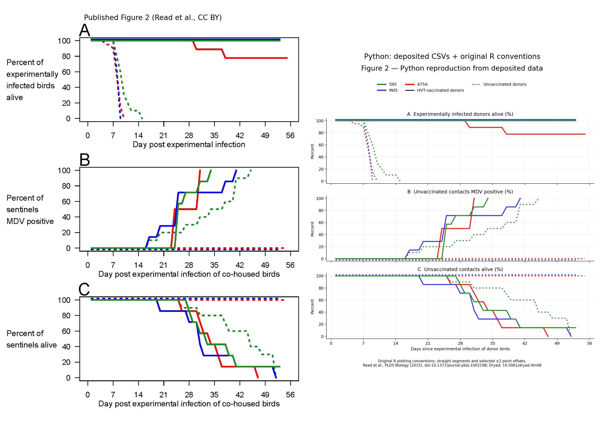

# Figure 2 reproduced from the actual Dryad data

**Update: Firefox successfully downloaded the original archive. The current Python analysis and local app use deposited bird-state tables, not image digitization.** This reproduces the published figure calculation, not a new animal experiment or a complete independent statistical replication.



## Sources and recovery

Primary paper: Read AF et al. (2015), *Imperfect Vaccination Can Enhance the Transmission of Highly Virulent Pathogens*, PLOS Biology 13(7):e1002198. [Paper and methods](https://doi.org/10.1371/journal.pbio.1002198).

Public data and original R code: Read et al., [Dryad DOI 10.5061/dryad.4tn48](https://doi.org/10.5061/dryad.4tn48). The relevant archive is [Fig2_and_S2.zip](https://datadryad.org/downloads/file_stream/46842), file ID 46842, 19,907 bytes. Its MD5 is `78419ef9559d4c5ad71de6888905bf0b`, matching the [repository metadata](https://datadryad.org/api/v2/files/46842). The dataset is CC0; the published figure is CC BY, credited to Read et al.

Initial programmatic downloads returned HTTP 403/401. At the user's request, I opened the public Dryad page in their existing Firefox browser and clicked the archive download. Automatic browser validation completed, and Firefox showed the download as completed. No credentials were extracted and no CAPTCHA was solved. The archive was copied into `data/Fig2_and_S2.zip` and verified before use. `sources/browser_download.json` records the recovery, byte count, checksum, and SHA-256; the earlier failure record is retained in `sources/download_attempt.json`.

The prior image-only work is retained as historical material in `REPORT_image_attempt.md`, `reproduce_image.py`, and the original image-derived outputs. Its former access limitations are historical, not the status of the current analysis.

## Experiment and interpretation of the data

Experiment 2 compares vaccination of experimentally infected donors, with unvaccinated contacts in all groups. It uses three existing MDV strains, 595, Md5, and 675A. Figure 2 shows donor survival (A), contact positivity (B), and contact survival (C). In every panel line style denotes **donor** vaccination. See the [paper's design and analysis methods](https://journals.plos.org/plosbiology/article?id=10.1371/journal.pbio.1002198).

The downloaded CSVs are the authors' prepared binary daily-state tables, not original qPCR amplification files or a complete animal/censoring ledger. Their availability resolves the figure's computational inputs but does not eliminate every reporting uncertainty.

## Exact computational method

`reproduce.py` reads the verified ZIP directly. It does not read the digitized coordinates, estimate pixels, or need the extracted copies. It parses the `read.table` selections in the deposited `Figure2_ThreePanel.R` and translates the original `100 * colMeans(...)` calculation:

- Panel A: `DataFor2A_v2.csv`.
- Panel B: `DataFor2C.csv` (the R script's internal section comment calls this “Figure 2C”; the displayed panel is B).
- Panel C: `DataFor2D_v2.csv` (internally called “Figure 2D”; displayed as C).

For each block it uses the original R `skip` and `nrows`, retains three metadata columns separately, and averages columns 4 onward. A value of one denotes alive in A/C or positive in B. The percentage is `100 × number of ones / included rows`. Denominators are fixed within each selected block, as in the original figure code; this is not a newly fitted Kaplan–Meier estimator or changing-risk-set calculation.

The R call `lines(y)` implicitly uses x=1,…,N. Python verifies that the CSV day headers equal that sequence, then uses those day values explicitly. No missing days are inferred. Each trace ends where its source table ends; it is not extrapolated.

Two presentations are produced:

1. **Publication reproduction:** straight line segments and the original selected display shifts. `JitterSize=2` adds 2 percentage points to vaccinated Md5 donors in A, subtracts 2 from contacts of unvaccinated Md5 donors in B, and adds 2 to contacts of unvaccinated Md5 donors in C. These offsets are now confirmed by the R code, not inferred from the image.
2. **Recorded-state view:** steps with the display shifts removed. This displays supplied daily states without implying a continuously changing percentage between day columns. It does not establish the exact moment of biological infection.

The local explorer offers both views. Its table always reports the actual daily fraction without display shifts, including numerator and denominator; publication lines may connect those daily observations. A gap after a trace ends means outside its supplied horizon, not a new observed outcome.

## Results from deposited records

For 595 positivity, the first supplied day with at least 50% positive is **day 25 with vaccinated donors (4/7)** versus **day 34 with unvaccinated donors (5/10)**: a **nine-day difference**, consistent with the paper. No interpolation is used for this calculation. No new p-value is claimed.

The table below reports final binary states within the precise blocks selected by the authors' figure script. A/C fractions are alive; B fractions are positive. End times differ, so these are not all measurements at one common follow-up date. Counts describe included records, not necessarily every originally assigned animal.

| Panel | Strain | Unvaccinated donors: final fraction | Vaccinated donors: final fraction |
|---|---|---|---|
| A | 595 | 0/10 on day 15 | 7/7 on day 53 |
| A | Md5 | 0/8 on day 9 | 7/7 on day 53 |
| A | 675A | 0/20 on day 10 | 7/9 on day 55 |
| B | 595 | 10/10 on day 45 | 7/7 on day 34 |
| B | Md5 | 0/8 on day 53 | 7/7 on day 41 |
| B | 675A | 0/9 on day 55 | 6/6 on day 31 |
| C | 595 | 0/10 on day 52 | 1/7 on day 53 |
| C | Md5 | 8/8 on day 53 | 0/7 on day 52 |
| C | 675A | 5/5 on day 55 | 0/7 on day 47 |

The direct-data reproduction visually agrees with the published major contrasts. Unvaccinated Md5/675A donors die early; their selected contacts remain negative. Contacts of vaccinated donors become positive and survival falls. The nine-day 595 result now comes from deposited records rather than an approximate image reading.

## Discrepancies and resolved uncertainties

- **Resolved: display offsets.** The R script explicitly applies ±2-point shifts. Percentages outside 0–100% in the original drawing are not biological values. The explorer's recorded-state view removes them.
- **Resolved: 595 unvaccinated-contact endpoint.** Its final deposited survival value is 0/10 at day 52. A dotted raster trace can visually end above zero because its last dash does not reach the line's endpoint. The earlier image-only reading was therefore insufficient for this endpoint.
- **Still unresolved: vaccinated-595 contact survival.** The supplied survival block has 1/7 alive through day 53. That agrees with the solid green plateau in Figure 2 but qualifies the Results prose describing all infected contacts eventually dying. No later outcome is supplied here; I do not force the curve to zero or infer that this animal subsequently died.
- **Different denominators across outcomes.** For vaccinated 675A, B uses 6 rows and C uses 7; for unvaccinated 675A, B uses 9 and C uses 5. These fractions cannot be treated as matched, complete original cohorts. Many record IDs are the placeholder `x`, preventing reliable individual linkage across files. I preserve the authors' selections and report the counts rather than inventing a reconciliation.
- **675A pooling needs qualification.** The methods describe pooled donor survival from additional isolators. The deposited figure script selects 20 unvaccinated donor rows and only 9 vaccinated donor rows. The code establishes what was plotted, but the archive alone does not explain all original removals or establish completeness of the pooled vaccinated cohort.
- **Figure versus inference.** The published statistical methods describe Kaplan–Meier/Mantel–Cox comparisons. The deposited plotting script instead averages prepared binary states. Reproducing that code does not independently reproduce the survival-analysis risk sets, exclusions, or reported p-value.
- **Visual styling differs.** Typography, legend placement, grid, and dash patterns differ from the original. Values are obtained from tables; no pixel-fitting error remains in the current curves. The comparison PNG is for visual QA, not an input to the calculation.

## What is demonstrated, and what is not

Under the tested conditions, anti-disease vaccination enabled existing highly lethal MDV strains to transmit where transmission was not observed from unvaccinated donor groups. This supports a mechanism by which survival protection can relax a transmission cost of high lethality. It also shows a survival benefit for vaccinated donors. [Read et al., Results and Discussion](https://doi.org/10.1371/journal.pbio.1002198).

My assessment of the inference limits:

- This is not observation of new virulence evolving. Pre-existing strains were compared; no new mutations or serial-passage evolutionary trajectory were demonstrated here.
- It cannot establish the historical cause of increasing MDV virulence or separate vaccination from changes in husbandry, host genetics, density, or lifespan. The authors explicitly acknowledge that historical attribution limit in their Discussion.
- No detected transmission in finite isolators does not establish impossibility of transmission or persistence in every unvaccinated population. A reproduction number, universal threshold, long-term equilibrium, and selection coefficient are not estimated here.
- It cannot establish an equivalent effect for human vaccines, a particular human pathogen, or COVID-19 vaccination. Those claims need pathogen-specific evidence; this paper predates COVID-19.
- Virulence in susceptible hosts is distinct from immune escape. The experiment does not identify their mutations or within-host competitive mechanisms.
- It is not a net-policy comparison. The mechanism alone does not quantify the total population benefit or harm of vaccination.

## Remaining study and reproduction limitations

1. **Clustering and size:** contacts share isolators and exposure. The main strain-by-treatment contact groups have one isolator each. Ten birds do not equal ten independent replicates of a housing-level transmission intervention. Donor-only groups do not add contact-transmission replication.
2. **Restricted setting:** breed, age, maternal-antibody status, vaccine regimen, strains, and experimental inoculation limit generalization. Contacts acquire infection naturally, but donor challenge route/dose do not reproduce all farm exposure conditions.
3. **Detection versus infection:** scheduled qPCR interval-censors acquisition; first sustained detection is not exact infection time. Supplied daily positivity states are prepared data, not a new daily laboratory assay. Genome detection is not infectious-particle titration.
4. **Secondary transmission:** infected contacts may infect other contacts. The experiment does not identify every transmission source or per-donor infectiousness.
5. **Endpoints and attrition:** humane-endpoint euthanasia represents infection-induced death; crowding-related removals were excluded according to the paper. Full original exclusion reasons, raw assay measurements, and a complete censoring ledger were not recovered or independently audited. Many table identifiers are placeholders.
6. **Mechanism versus isolated mediation:** vaccination changes survival, replication, and exposure together; no survival-only mediation effect is estimated while holding other pathways fixed.
7. **Scope:** only Figure 2's 18 curves were reproduced. Figures 1, 3, 4 and S1–S3, shedding calculations, and maternal/commercial-bird experiments were not numerically replicated. Later 595/Md5 dust can include contact shedding, limiting donor-specific interpretation elsewhere in the paper.
8. **Verification:** Python validates the checksum, original selections, binary states, monotonicity, day headers, and means against direct counts. The R interpreter was unavailable, so original R was inspected and translated, not executed as an independent cross-language test. Reported hypothesis tests, confidence intervals, and alternate censoring analyses were not rerun.
9. **Independence:** these are original deposited data, not new animals or an independent experimental replication. Shared errors in supplied tables or original selection conventions could remain. No exhaustive subsequent-literature review, retraction audit, or policy evaluation was performed.

## Run locally

From the repository root, using the previously installed Python environment:

```bash
reproduction/.venv/bin/python reproduction/reproduce.py
python3 research-walkthrough/prepare_assets.py
python3 research-walkthrough/serve.py
```

Then open http://localhost:8080 and refresh. On a fresh setup, create the virtual environment and install `reproduction/requirements.txt`. The verified archive is already included locally. The direct HTTP downloader remains available as a recovery attempt, but is not required for this offline reproduction.

Outputs: `data_curves.json` with the selected binary records and metadata, `data_summary.json`, `figure2_from_data.png`/SVG, `figure2_states.png`/SVG, and `data_comparison.png`. The original ZIP and extracted R/CSV sources are preserved. The prior image-based attempt remains available for audit history.

## Validation of this update

Five Python checks passed for original table-block record counts, the nine-day 595 contrast, the preserved 1/7 survival endpoint, the Md5/675A transmission contrast, and separation of display offsets from biological values. DOM checks passed for navigation, six process steps, three panels, filters, playback, five notebook views, the record inspector, and both presentation modes. The updated app was also loaded in Firefox; its data-recovery banner, chart rendering, and 595 day-34 table values (7/7 versus 5/10) were verified through the UI. This browser check covered those views, not an exhaustive device/browser matrix.
