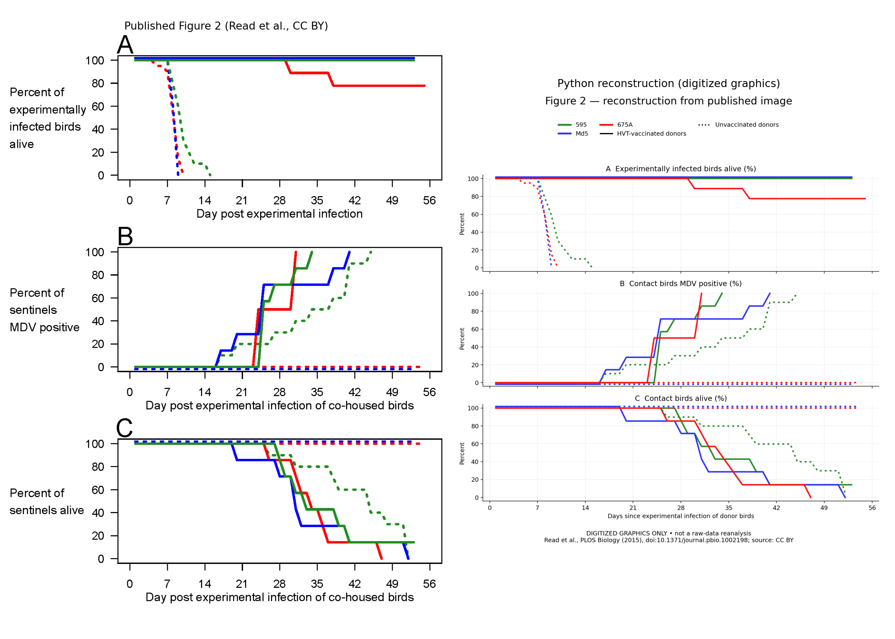

# Read et al. (2015): Figure 2 reproduction attempt

**Result: public dataset located; raw-data reproduction blocked by download access. All three panels of the major transmission figure were reconstructed in Python from the published image. This is a graphical reconstruction, not an independent statistical replication.**



## Sources and acquisition

The primary paper is Read AF et al. (2015), *Imperfect Vaccination Can Enhance the Transmission of Highly Virulent Pathogens*, PLOS Biology 13(7):e1002198, [doi:10.1371/journal.pbio.1002198](https://doi.org/10.1371/journal.pbio.1002198). I read its Results, Discussion, Materials and Methods, figure captions, and supporting-information descriptions. I did not retrieve and analyze every supplementary attachment or cited study.

The paper identifies [Dryad DOI 10.5061/dryad.4tn48](https://doi.org/10.5061/dryad.4tn48) as its public data/code repository. The repository lists four archives, one for each experiment, including the authors' R code. Its displayed publication date is July 6, 2016, distinct from the paper's July 27, 2015 date. Figure 2 and supplementary Figure S2 correspond to `Fig2_and_S2.zip`.

The official [file metadata](https://datadryad.org/api/v2/files/46842) records 19,907 bytes and MD5 `78419ef9559d4c5ad71de6888905bf0b`. Dataset and file-list metadata are preserved in `sources/dryad_dataset.json` and `sources/dryad_files.json`. Metadata availability does not mean I obtained the archive.

On November 6, 2026, the official [browser download](https://datadryad.org/downloads/file_stream/46842) returned HTTP 403; the [API download](https://datadryad.org/api/v2/files/46842/download) returned HTTP 401 with a bearer-token requirement. Additional public route checks did not recover a copy. No browser was available through the computer-use tool. No authentication or CAPTCHA was bypassed. `sources/download_attempt.json` records a repeatable check of the two official download routes. This is a limitation of this session, not evidence the data are permanently unavailable or invalid.

The [publisher's Figure 2 PNG](https://journals.plos.org/plosbiology/article/figure/image?download=&id=10.1371/journal.pbio.1002198.g002&size=large) downloaded successfully and is preserved as `sources/published_figure2.png`. Original figure attribution: Read et al., PLOS Biology (2015), CC BY. Dryad metadata specifies CC0 for the dataset.

## What the selected experiment measured

Experiment 2 used maternal-antibody-negative Rhode Island Red chicks, with ten experimentally infected donors and ten unvaccinated contacts per main isolator. Donors received HVT or no vaccine, then one of three existing MDV strains. Two additional 675A donor-only groups supplied pooled survival observations. Blood qPCR identified contact positivity at scheduled samples. Humane-endpoint euthanasia counted as infection-induced death; birds culled to relieve crowding were excluded from survival calculations. See the paper's [Experiment 2 and statistical methods](https://journals.plos.org/plosbiology/article?id=10.1371/journal.pbio.1002198#sec003).

Figure 2 presents donor survival (A), contact positivity (B), and contact survival (C). In every panel, solid/dotted denotes **donor** vaccination. All contacts in this experiment were unvaccinated. Confusing those line types with contact vaccination reverses the interpretation.

## Python reconstruction method

1. Preserve the publisher PNG at its original 1269 × 1668 pixels.
2. Manually transcribe visible polyline vertices, separating three colors and two line styles in each of three panels. The resulting 18 traces are in `data/digitized_figure2.json`. These are graphic coordinates, not reconstructed individual birds. Hidden overlapping segments require visual interpretation.
3. Calibrate the horizontal axis with day 0 at x=352 and day 56 at x=1231. Calibrate each vertical axis with its 0% and 100% tick centers: A=(412,74), B=(974,636), C=(1536,1198), in image y coordinates.
4. Convert each pixel vertex using:

   `day = (x - 352) * 56 / 879`

   `drawn_percent = (y_zero - y) * 100 / (y_zero - y_hundred)`

5. Connect vertices with straight lines to reproduce the published drawing. This deliberately preserves its sloping transitions. These are **not** fitted Kaplan–Meier curves, daily prevalence estimates, or interpolated biological trajectories.
6. Preserve drawn offsets rather than silently clipping percentages. Blue traces visibly extend about two percentage points above 100% or below 0%; these appear to separate coincident lines, but the unavailable R code prevents confirming their origin. Plot limits accommodate them; they have no biological meaning.
7. Export PNG, SVG, calibrated JSON coordinates, and a side-by-side comparison. Visual inspection checked colors, line semantics, axes, and the major transitions. Code checks require nondecreasing x coordinates and finite transformed y values.

The horizontal scale is 0.0637 day/pixel; the vertical scale is 0.2959 percentage point/pixel. A 2–4 pixel placement error translates to roughly 0.13–0.25 day and 0.6–1.2 percentage points before ambiguity from overlaps or endpoints. This is an illustrative resolution calculation, **not a measured error bound or confidence interval**.

## Results and discrepancies

The following values are approximate readings of Figure 2, not independent estimates from experimental records:

| Feature | Published graphic and Python reconstruction |
|---|---|
| Unvaccinated Md5/675A donors | Survival falls to zero around days 9–10 |
| Contacts of unvaccinated Md5/675A donors | Positivity stays at 0%; survival stays near 100% |
| Contacts of vaccinated Md5/675A donors | Positivity reaches about 100%; survival subsequently falls |
| Contacts exposed to strain 595 | Both donor groups transmit; positivity develops earlier with vaccinated donors |
| 595 50% positivity crossing | Approximately day 24.9 versus day 34.0: about nine days earlier with vaccinated donors |

The nine-day graphical difference agrees with the published description. It does not independently reproduce its significance test. The paper reports a Kaplan–Meier/Mantel–Cox analysis; I did not recreate individual event times, risk sets, censoring, confidence intervals, or p-values.

Specific discrepancies and unresolved issues:

- **Input differs fundamentally:** the intended inputs were Dryad observations and R code; the actual input is the publisher image. Visual agreement is expected from transcription and cannot validate the original analysis.
- **Appearance differs:** typography, aspect ratio, legend, grid, and dash spacing were redesigned for readability. Vertex locations are approximate; small transitions or overlapping segments may be missed.
- **No invented denominators:** nominal groups contain ten contacts, but exclusion/attrition can change analysis denominators. Graphic fractions must not be converted into exact bird counts without the records.
- **Caption simplification:** the caption describes ten donor birds per group, while the methods say 675A survival pools twenty per vaccination status. Raw replication would need to implement this distinction explicitly.
- **Survival versus prose:** the plotted solid green contact-survival curve ends near 14% at about day 53; the dotted green curve ends slightly above zero. The Results describe all infected contacts eventually dying. The image alone does not resolve exclusions, end-of-follow-up, or the basis for that wording. I preserved the visible endpoints and did not extend curves to force agreement. This is an unresolved documentation issue, not proof of a biological contradiction.
- **Incomplete scope:** Figures 1, 3, 4 and S1–S3 were not reproduced. The shedding calculations and additional maternal/commercial-bird experiments were not numerically audited.

## What the evidence demonstrates—and what it does not

**Demonstrated within these experimental conditions:** anti-disease protection allowed existing highly lethal MDV strains to pass between birds under conditions where transmission was not observed from unvaccinated donors. This supports a mechanism by which vaccination can relax a transmission cost of high lethality. The vaccine also protected donors from early mortality. These interpretations follow the [primary paper](https://doi.org/10.1371/journal.pbio.1002198).

The following are my assessments of the inferential scope of that design:

- **Not observed de novo evolution.** Researchers challenged birds with pre-existing strains; this was not a serial-passage experiment showing new virulence mutations arise under vaccination. Altering the transmission opportunities of existing strains is distinct from creating them.
- **Not historical causal attribution.** The design cannot determine whether vaccination caused the historical rise of MDV virulence, or separate its contribution from changing husbandry, host genetics, density, and lifespan. The authors explicitly acknowledge the historical attribution limit in the [Discussion](https://journals.plos.org/plosbiology/article?id=10.1371/journal.pbio.1002198#sec002).
- **Not a universal persistence threshold.** No detected transmission in these finite isolators does not prove a strain can never transmit or persist in any unvaccinated population. A contact experiment is not a direct estimate of a population reproduction number or long-term equilibrium.
- **Not a human-vaccine result.** This animal experiment cannot establish that human vaccination, a particular human vaccine, or SARS-CoV-2 vaccination increases virulence. Such conclusions need pathogen-specific evidence about protection, transmission, selection, and actual evolutionary change. The paper predates COVID-19.
- **Not equivalence of virulence and immune escape.** Disease severity in susceptible hosts and antigenic evasion are different traits. These data do not identify the mutations or within-host competitive mechanisms responsible for either.
- **Not a net-policy comparison.** A mechanism that can facilitate transmission of lethal strains does not quantify whether vaccination increases total population harm. That requires vaccine benefits, coverage, externalities, alternatives, and long-term outcomes. This reconstruction supplies none of those estimates.

## Study and measurement limitations relevant to interpretation

- **Small, clustered groups:** contacts share an isolator and infectious environment. Main strain-by-treatment contact outcomes come from one isolator each; ten birds are not ten independent replicates of housing-level transmission. Room/isolator effects and shared exposures limit precision and generalization. Extra donor-only groups do not add independent contact-transmission replicates.
- **Restricted host/vaccine/strain conditions:** the selected experiment uses a particular chicken breed, age, maternal-antibody status, HVT regimen, and three MDV strains. It does not cover all poultry settings. The wider paper supplies additional contexts, but this reconstruction did not audit them.
- **Challenge versus natural exposure:** donors were experimentally inoculated, so their dose and route differ from natural acquisition. Contacts supply the natural-transmission observation; this does not make donor challenge conditions representative of farms.
- **Detection is not acquisition time:** scheduled qPCR testing interval-censors when infection actually began. First sustained detection cannot identify the precise exposure time or an individual transmission event.
- **PCR is not infectious-virus titration:** genome detection alone is not a direct measure of infectious particle count. Contact infections strengthen the transmission argument, but do not calibrate an exact infectious dose.
- **Secondary transmission:** once contacts become infectious, later contact infections may arise from other contacts. The figure does not identify each transmission source or isolate per-donor infectiousness.
- **Endpoint and attrition conventions:** humane-endpoint euthanasia substitutes for natural death, and crowding-related removals affect denominators. Without raw records I cannot assess the impact of exclusions or implement an alternative censoring analysis.
- **Mechanism versus isolated mediation:** longer survival, replication, and exposure all change together. Figure 2 alone does not estimate a survival-only causal mediation effect while holding other pathways fixed.
- **Shedding in the wider paper:** total genome shedding is a proxy for fitness, not a directly measured selection coefficient. In Experiment 2, dust from 595/Md5 groups can include contact-bird shedding later in follow-up; the paper notes this contamination. It does not affect the graphical transcription here, but limits donor-specific shedding interpretation.
- **No new independent evidence:** this computational work re-expresses an existing figure. It adds accessibility and an audit trail, not new animals, independent replication, or updated epidemiological evidence. No exhaustive subsequent-literature review, retraction audit, or policy evaluation was performed.

## Re-run and inspect

From the repository root:

```bash
python3 -m venv reproduction/.venv
reproduction/.venv/bin/python -m pip install -r reproduction/requirements.txt
reproduction/.venv/bin/python reproduction/download_data.py
reproduction/.venv/bin/python reproduction/reproduce.py
```

Python 3.9 was used. The downloader records failure without manufacturing a ZIP; a future successful response must match Dryad's MD5 before it is saved. Even if a future download succeeds, `reproduce.py` remains an image-reconstruction program: a separate raw-data analysis must then be implemented after reading the archive's schema and R code.

The plotting script runs offline from the included image and JSON. It produces `outputs/figure2_reconstructed.png`, its editable SVG equivalent, `outputs/comparison.png`, and `outputs/digitized_coordinates.json`. No tests of biological hypotheses were run. The nine-day comparison is descriptive, not a newly calculated inferential result.
